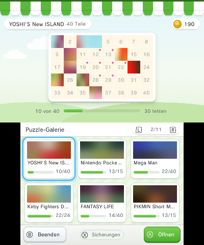
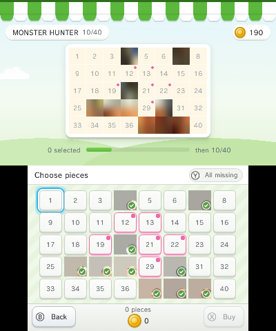
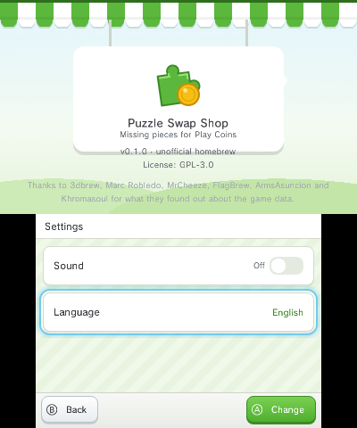
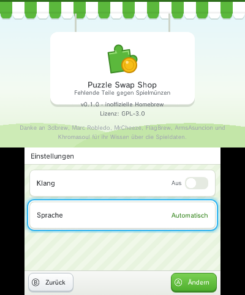

# Puzzle Swap Shop

[](https://github.com/toomium/puzzle-swap-shop/actions/workflows/ci.yml)
[](LICENSE)

**English** · [Deutsch](#deutsch)

A homebrew app for the Nintendo 3DS: pick exactly the Puzzle Swap pieces you are missing in StreetPass Mii Plaza and buy them with your Play Coins. A piece costs 5 Play Coins by default (you can change that), and there is no randomness any more.



> **Status:** Version 1.0.0. The app has only been tested on a **European** console so far. The USA and Japan regions are built in but untested.

## Features

- See all puzzles with your progress and their real pictures in one gallery, with names in your console's language.
- Choose the missing pieces you want and buy them: 5 Play Coins per piece, 10 per rare (pink) piece.
- A backup is created automatically before every purchase and checked.
- Restore any backup from inside the app, and even a restore can be undone.
- German and English, following your system language.
- Buttons and touch screen. The app never quits on Ⓑ alone; quitting asks first.

## Requirements

- A Nintendo 3DS, 2DS, New 3DS or New 2DS running **Luma3DS** (custom firmware).
- **StreetPass Mii Plaza**, latest version, started at least once. Supported regions: Europe, USA and Japan.
- An SD card with a little free space for backups (a few MB).

## Installation

Download the latest version from the [Releases](../../releases) page. There are two options:

**As an app on the HOME Menu (CIA)**

1. Copy `puzzle-swap-shop.cia` to your SD card.
2. Install it with FBI.
3. The app appears on the HOME Menu.

**Through the Homebrew Launcher (3DSX)**

1. Copy `puzzle-swap-shop.3dsx` to `sdmc:/3ds/`.
2. Open the Homebrew Launcher and start "Puzzle Swap Shop".

## Before you start: make your own backup

The app creates its own backups. Still, make a separate copy of your own **before the first launch**.

Important: **Checkpoint is not enough.** For Mii Plaza, Checkpoint only backs up the extdata, not the save data that holds your puzzle pieces. Copy that with GodMode9:

1. Start GodMode9 (on most Luma setups, hold START while powering on).
2. Open `[1:] SYSNAND CTRNAND`, then `data`, the folder with the long name, `sysdata` and the folder for your region: `00020228` (Europe), `00020218` (USA) or `00020208` (Japan).
3. Select the file `00000000` with Ⓐ and choose "Copy to 0:/gm9/out".
4. Copy the `gm9/out` folder from the SD card to your computer and keep it there.

You can also back up the StreetPass Mii Plaza extdata with Checkpoint.

## Pictures of the first 7 puzzles (one time)

The pictures of the puzzles that come with Mii Plaza itself (Metroid: Other M, Mario & Bowser, Super Mario Galaxy 2, Zelda, Kirby, Pikmin and New Super Mario Bros. Wii) are part of Mii Plaza's program files. For legal reasons this app does not ship them, and it is not allowed to open them itself. Everything works without this step, only these seven puzzles show a placeholder pattern instead of the picture, and the gallery reminds you at every start.

A GodMode9 script copies the seven pictures from your own Mii Plaza installation to the SD card:

1. Copy `tools/gm9/extract_panels.gm9` (Europe) from this repository to `sdmc:/gm9/scripts/`. For the USA there is `extract_panels_usa.gm9`, for Japan `extract_panels_jpn.gm9`.
2. Start GodMode9, press HOME, choose "Scripts…" and run the script. It only writes to the SD card, to `sdmc:/3ds/PuzzleSwapShop/panels/`.
3. Start Puzzle Swap Shop. The pictures show up right away.

> ⚠️ The script for **Europe** has been tested on a console. The scripts for the **USA and Japan** are **untested**: title ID and file name are derived from the European version and may differ. If copying fails, the top of the script says what to adjust. Please tell us in the [Issues](../../issues) what worked for you.

## How it works

1. **First launch:** The app backs up your Mii Plaza save data and your Play Coins to the SD card. This **original backup** is always kept. You can't buy anything without it.
2. **Gallery:** Choose a puzzle. L and R flip pages. Completed puzzles carry a star.
3. **Choose pieces:** Tap the missing pieces you want. Ⓨ selects all missing pieces.
4. **Buy:** The app shows the number of pieces and the price and asks you to confirm. Please don't turn off the system during the purchase; it usually takes less than a second.
5. **Done:** The new pieces show up in Mii Plaza right away.



### Rare (pink) pieces

Mii Plaza has pieces you can't get with Play Coins in the game, only through StreetPass. This app can still buy them for **10 Play Coins** each and marks them with a pink dot. This works for puzzles with 40 pieces (eight pieces per puzzle); puzzles with 15 pieces have none. For puzzles with 24 pieces the app doesn't mark any rare pieces yet, so they cost the normal price.

### Prices

The app writes `sdmc:/3ds/PuzzleSwapShop/settings.ini` on its first start. Open it on your computer or on the console to change the prices (Play Coins per piece, 1 to 300):

```ini
price_per_piece=5
price_rare_piece=10
```

With `price_rare_piece=0`, rare pieces are not sold. Changes apply the next time you start the app.

### Settings

Press START to open the settings: sound on or off, language (automatic, German or English). The version is shown at the top.



## Backups

- Before **every** purchase, the app creates a backup and checks it before changing anything.
- All backups are stored in `sdmc:/3ds/PuzzleSwapShop/backups/`. The original backup is called `000-original`.
- Don't delete this folder while you use the app. If you run low on space, copy older backups to your computer.

## Restoring

1. Open **Backups** in the app (Ⓧ in the gallery).
2. Choose a backup, for example "before purchase: Summer Meadow, 3 pieces" or the original backup.
3. Confirm **Restore**.

Before the app writes back an older state, it backs up the current one ("before restore"). So you can undo a restore as well.

If a purchase is interrupted (for example because the battery ran out), the app tells you on the next launch and recommends restoring the state from before the purchase.

If the app no longer starts at all, you still have your own GodMode9 copy. Use GodMode9 to copy `00000000` back to the same place you got it from. GodMode9 will ask you to unlock write permissions.

## FAQ

**Can I get banned for this?** The app only changes data on your console and has nothing to do with online services. We still can't give any guarantee.

**Why are some SpotPass puzzles missing?** The app only shows puzzles that exist on your console. SpotPass puzzles you haven't downloaded appear greyed out.

**Why do the first 7 puzzles only show a pattern?** See [Pictures of the first 7 puzzles](#pictures-of-the-first-7-puzzles-one-time).

**The app says "This save data looks different than expected".** It can't safely recognise your save data, so it doesn't change anything. Feel free to report it in the [Issues](../../issues), but don't upload your save data.

## Disclaimer

Puzzle Swap Shop is unofficial homebrew. It is not affiliated with, endorsed or reviewed by Nintendo. StreetPass Mii Plaza, Puzzle Swap and Nintendo 3DS are trademarks of Nintendo. This repository contains no game graphics and no save data from Nintendo.

The app changes real game data. It is built carefully and creates a backup before every change, but bugs can never be ruled out completely. **Use it at your own risk.** The software comes without any warranty; see [LICENSE](LICENSE) (GPL-3.0).

## Credits

What we know about the game data comes from the work of 3dbrew, Marc Robledo (Savegame Editors), MrCheeze (playcoin), FlagBrew (Checkpoint), ArmsAsuncion and Khromasoul (StreetPassPuzzleEditor), and from The Cutting Room Floor wiki.

## For developers

Build with devkitPro (devkitARM, libctru, citro2d): `make` builds the `.3dsx`, `make cia` the `.cia` (needs makerom and bannertool), `make diag` a diagnosis build. Host tests for the platform-independent code: `make -f Makefile.host test`.

---

<a id="deutsch"></a>

# Puzzle Swap Shop (Deutsch)

[English](#puzzle-swap-shop) · **Deutsch**

Eine Homebrew-App für den Nintendo 3DS: Wähle in Puzzle Swap (StreetPass Mii Plaza) genau die Puzzleteile aus, die dir fehlen, und kaufe sie mit deinen Spielmünzen. Ein Teil kostet standardmäßig 5 Spielmünzen (einstellbar), und es gibt keinen Zufall mehr.


> **Status:** Version 1.0.0. Die App ist bisher nur auf einer **europäischen** Konsole getestet. Die Regionen USA und Japan sind eingebaut, aber ungetestet.

## Was die App kann

- Alle Puzzles mit Fortschritt und echten Bildern in einer Galerie zeigen, mit dem Namen in der Sprache deiner Konsole.
- Fehlende Teile gezielt auswählen und kaufen: 5 Spielmünzen pro Teil, 10 pro seltenem (rosa) Teil.
- Vor jedem Kauf automatisch eine Sicherung anlegen und sie prüfen.
- Jede Sicherung in der App wiederherstellen, auch die Wiederherstellung selbst lässt sich rückgängig machen.
- Deutsch und Englisch, passend zur Sprache der Konsole.
- Bedienung per Tasten und Touchscreen. Die App schließt nie durch Ⓑ allein, Beenden fragt nach.

## Voraussetzungen

- Ein Nintendo 3DS, 2DS, New 3DS oder New 2DS mit **Luma3DS** (Custom Firmware).
- **StreetPass Mii Plaza** in der neuesten Version, mindestens einmal gestartet. Unterstützt werden die Regionen Europa, USA und Japan.
- Eine SD-Karte mit etwas freiem Platz für die Sicherungen (wenige MB).

## Installation

Lade die neueste Version von der Seite [Releases](../../releases) herunter. Du hast zwei Möglichkeiten:

**Als App im HOME-Menü (CIA)**

1. `puzzle-swap-shop.cia` auf die SD-Karte kopieren.
2. Mit FBI installieren.
3. Die App erscheint im HOME-Menü.

**Über den Homebrew Launcher (3DSX)**

1. `puzzle-swap-shop.3dsx` nach `sdmc:/3ds/` kopieren.
2. Den Homebrew Launcher öffnen und „Puzzle Swap Shop“ starten.

## Bevor du anfängst: eigene Sicherung

Die App legt selbst Sicherungen an. Trotzdem solltest du **vor dem ersten Start** eine eigene Kopie machen, die unabhängig von der App ist.

Wichtig: **Checkpoint reicht dafür nicht.** Checkpoint sichert bei Mii Plaza nur die Extdata, nicht den Spielstand mit den Puzzleteilen. Den kopierst du mit GodMode9:

1. GodMode9 starten (bei den meisten Luma-Installationen beim Einschalten START halten).
2. `[1:] SYSNAND CTRNAND` öffnen, dann `data`, den Ordner mit dem langen Namen, `sysdata` und den Ordner deiner Region: `00020228` (Europa), `00020218` (USA) oder `00020208` (Japan).
3. Die Datei `00000000` mit Ⓐ wählen und „Copy to 0:/gm9/out“ nehmen.
4. Den Ordner `gm9/out` von der SD-Karte auf deinen PC kopieren und dort aufbewahren.

Zusätzlich kannst du mit Checkpoint die Extdata von StreetPass Mii Plaza sichern.

## Bilder der ersten 7 Puzzles (einmalig)

Die Bilder der Puzzles, die schon mit Mii Plaza mitkommen (Metroid: Other M, Mario & Bowser, Super Mario Galaxy 2, Zelda, Kirby, Pikmin und New Super Mario Bros. Wii), liegen im Programm von Mii Plaza. Aus rechtlichen Gründen liefert diese App sie nicht mit, und sie darf sie auch nicht selbst öffnen. Ohne diesen Schritt funktioniert alles, nur diese sieben Puzzles zeigen ein Platzhalter-Muster statt des Bildes, und die Galerie erinnert dich bei jedem Start daran.

Ein GodMode9-Skript kopiert die sieben Bilder aus deiner eigenen Mii-Plaza-Installation auf die SD-Karte:

1. `tools/gm9/extract_panels.gm9` (Europa) aus diesem Repository nach `sdmc:/gm9/scripts/` kopieren. Für die USA gibt es `extract_panels_usa.gm9`, für Japan `extract_panels_jpn.gm9`.
2. GodMode9 starten, die Taste HOME drücken, „Scripts…“ wählen und das Skript starten. Es schreibt nur auf die SD-Karte, nach `sdmc:/3ds/PuzzleSwapShop/panels/`.
3. Puzzle Swap Shop starten. Die Bilder erscheinen sofort.

> ⚠️ Das Skript für **Europa** ist auf einer Konsole getestet. Die Skripte für **USA und Japan** sind **ungetestet**: Titel-Nummer und Dateiname sind aus der EUR-Fassung abgeleitet und können abweichen. Klappt das Kopieren nicht, stehen im Skript oben Hinweise, was anzupassen ist. Berichte gern in den [Issues](../../issues), was bei dir funktioniert hat.

## So funktioniert es

1. **Erster Start:** Die App sichert deinen Mii-Plaza-Spielstand und deine Spielmünzen auf der SD-Karte. Diese **Ursicherung** bleibt immer erhalten. Ohne sie ist kein Kauf möglich.
2. **Galerie:** Wähle ein Puzzle. L und R blättern. Fertige Puzzles tragen einen Stern.
3. **Teile auswählen:** Tippe die fehlenden Teile an, die du willst. Ⓨ wählt alle fehlenden Teile.
4. **Kaufen:** Die App nennt Anzahl und Preis und fragt nach. Während des Kaufs bitte nicht ausschalten; es dauert meist unter einer Sekunde.
5. **Fertig:** Die neuen Teile sind sofort in Mii Plaza zu sehen.


### Seltene (rosa) Teile

In Mii Plaza gibt es Teile, die du im Spiel nicht mit Spielmünzen bekommst, sondern nur per StreetPass. Diese App kann sie trotzdem für **10 Spielmünzen** pro Teil kaufen. Die App kennzeichnet sie mit einem rosa Punkt. Das funktioniert bei Puzzles mit 40 Teilen (dort sind es acht Teile pro Puzzle); Puzzles mit 15 Teilen haben keine. Bei Puzzles mit 24 Teilen markiert die App noch keine seltenen Teile, sie kosten wie normale.

### Preise

Die App legt beim ersten Start `sdmc:/3ds/PuzzleSwapShop/settings.ini` an. Öffne sie am Computer oder auf der Konsole, um die Preise zu ändern (Spielmünzen pro Teil, 1 bis 300):

```ini
price_per_piece=5
price_rare_piece=10
```

Bei `price_rare_piece=0` werden seltene Teile nicht verkauft. Änderungen gelten beim nächsten Start der App.

### Einstellungen

Mit START öffnest du die Einstellungen: Klang an oder aus, Sprache (automatisch, Deutsch oder English). Oben steht die Version.



## Sicherungen

- Vor **jedem** Kauf legt die App eine Sicherung an und prüft sie, bevor sie etwas verändert.
- Alle Sicherungen liegen unter `sdmc:/3ds/PuzzleSwapShop/backups/`. Die Ursicherung heißt `000-original`.
- Lösche diesen Ordner nicht, solange du die App benutzt. Wenn dir der Platz ausgeht, kannst du ältere Sicherungen auf deinen PC kopieren.

## Wiederherstellen

1. In der App **Sicherungen** öffnen (Ⓧ in der Galerie).
2. Eine Sicherung wählen, zum Beispiel „vor Kauf: Sommerwiese, 3 Teile“ oder die Ursicherung.
3. **Wiederherstellen** bestätigen.

Bevor die App einen alten Stand zurückschreibt, sichert sie den aktuellen Stand („vor Wiederherstellung“). Du kannst also auch eine Wiederherstellung rückgängig machen.

Wird ein Kauf unterbrochen (zum Beispiel weil der Akku leer ist), meldet die App das beim nächsten Start und empfiehlt, den Stand vor dem Kauf wiederherzustellen.

Startet die App gar nicht mehr, bleibt deine eigene Kopie aus GodMode9. Kopiere `00000000` mit GodMode9 an dieselbe Stelle zurück, von der du sie geholt hast. GodMode9 fragt dabei nach der Schreibberechtigung.

## Häufige Fragen

**Kann ich damit gesperrt werden?** Die App ändert nur Daten auf deiner Konsole und hat nichts mit Online-Diensten zu tun. Eine Garantie können wir trotzdem nicht geben.

**Warum fehlen manche SpotPass-Puzzles?** Die App zeigt nur Puzzles, die auf deiner Konsole vorhanden sind. Nicht heruntergeladene SpotPass-Puzzles erscheinen ausgegraut.

**Warum zeigen die ersten 7 Puzzles nur ein Muster?** Siehe [Bilder der ersten 7 Puzzles](#bilder-der-ersten-7-puzzles-einmalig).

**Die App meldet „Dieser Spielstand sieht anders aus als erwartet“.** Dann erkennt sie deinen Spielstand nicht sicher und verändert zur Sicherheit nichts. Melde dich gern über die [Issues](../../issues), ohne deinen Spielstand hochzuladen.

## Haftungsausschluss

Puzzle Swap Shop ist inoffizielle Homebrew. Die App ist nicht mit Nintendo verbunden und wird von Nintendo weder unterstützt noch geprüft. StreetPass Mii Plaza, Puzzle Swap und Nintendo 3DS sind Marken von Nintendo. Dieses Repository enthält keine Spielgrafiken und keine Spielstände von Nintendo.

Die App verändert echte Spieldaten. Sie ist sorgfältig gebaut und legt vor jeder Änderung eine Sicherung an, trotzdem kann ein Fehler nicht ausgeschlossen werden. **Die Nutzung erfolgt auf eigene Gefahr.** Die Software wird ohne jede Gewährleistung bereitgestellt, siehe [LICENSE](LICENSE) (GPL-3.0).

## Danksagungen

Die Kenntnisse über die Spieldaten stammen aus der Arbeit von 3dbrew, Marc Robledo (Savegame Editors), MrCheeze (playcoin), FlagBrew (Checkpoint), ArmsAsuncion und Khromasoul (StreetPassPuzzleEditor) sowie aus dem Wiki von The Cutting Room Floor.

## Für Entwickler

Bauen mit devkitPro (devkitARM, libctru, citro2d): `make` erzeugt die `.3dsx`, `make cia` die `.cia` (braucht makerom und bannertool), `make diag` einen Diagnose-Build. Host-Tests für den plattformunabhängigen Code: `make -f Makefile.host test`.
